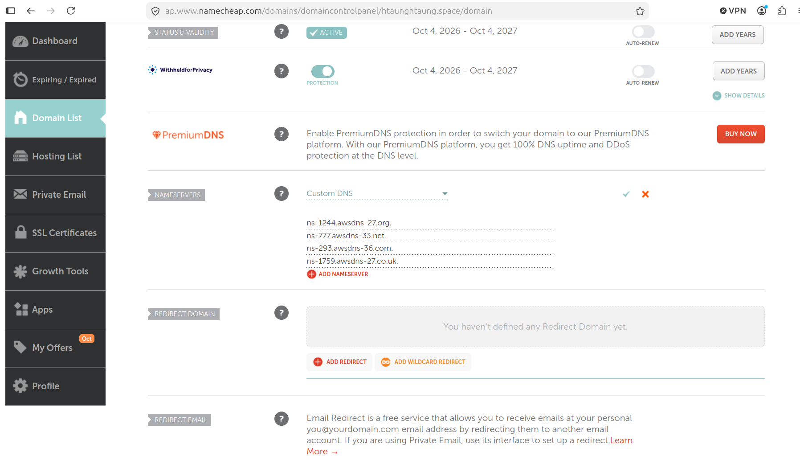

#### Ref 
```
https://vcloudynet.blogspot.com/2017/02/lab-route53-geolocation-routing-policy.html

https://vcloudynet.blogspot.com/2017/02/lab-route53-geolocation-routing-policy_13.html

https://vcloudynet.blogspot.com/2017/02/lab-route53-geolocation-routing-policy_77.html

```

#### Route 53 creates NS and SOA records. 
- Copy the four NS values (like ns-123.awsdns-45.com) in DNS provider (namecheap) 
```
Route 53 NS Records

ns-1244.awsdns-27.org
ns-777.awsdns-33.net
ns-293.awsdns-36.com
ns-1759.awsdns-27.co.uk
```



#### Verify NS Record works
```
root@Aung-Ubuntu:/home/aung# dig NS htaunghtaung.space  @8.8.8.8 +short
ns-293.awsdns-36.com.
ns-1244.awsdns-27.org.
ns-1759.awsdns-27.co.uk.
ns-777.awsdns-33.net.

```


### Re-use same reource of Route53_geolocation and deployed as docker container
#### Install docker engine on Amazon Linux 2023 and start docker compose up
- 1. Install and start Docker
``` 
sudo dnf update -y
sudo dnf install -y docker
sudo systemctl enable --now docker
```

- 2. Run Docker without sudo
```
sudo usermod -aG docker $USER
newgrp docker
```

- 3. Install the Compose plugin
```
sudo mkdir -p /usr/local/lib/docker/cli-plugins
sudo curl -SL https://github.com/docker/compose/releases/latest/download/docker-compose-linux-$(uname -m) \
  -o /usr/local/lib/docker/cli-plugins/docker-compose
sudo chmod +x /usr/local/lib/docker/cli-plugins/docker-compose

```

- 4. Install a newer buildx (needed for builds)
```
ARCH=$(uname -m | sed 's/x86_64/amd64/; s/aarch64/arm64/')
sudo curl -SL https://github.com/docker/buildx/releases/download/v0.19.3/buildx-v0.19.3.linux-$ARCH \
  -o /usr/local/lib/docker/cli-plugins/docker-buildx
sudo chmod +x /usr/local/lib/docker/cli-plugins/docker-buildx
```

5. Verify
```
docker --version
docker compose version
docker buildx version
```

```
git clone https://github.com/dockersamples/example-voting-app

cd example-voting-app

docker compose up -d

8080 for voting, will use this as voting.htaunghtaung.space
8081 for voting result, will use htaunghtaung.space
```


#### openssl self-signed cert generation for domain
```
mkdir private
cd private

=> Step 1 Root CA => CA Private Key
openssl genrsa -out rootCA.key 4096
chmod 600 rootCA.key

=> ROOT CA Certificate
openssl req -x509 -new -key rootCA.key -sha256 -days 3650 -out rootCA.crt
Common Name (eg, your name or your server's hostname) []:*.htaunghtaung.space


Step2 => Generate cert for main_domain so called htaunghtaung.space
openssl genrsa -out main_domain.key 2048
chmod 600 main_domain.key


=> Request CSR
openssl req -new -key main_domain.key -out main_domain.csr -subj "/CN=htaunghtaung.space"

=> Configure SAN
vi main_domain.ext
subjectAltName = DNS:htaunghtaung.space
basicConstraints = CA:FALSE
keyUsage = digitalSignature, keyEncipherment
extendedKeyUsage = serverAuth

Step 3 => Sign cert with Root CA
openssl x509 -req -in main_domain.csr -CA rootCA.crt -CAkey rootCA.key -CAcreateserial -out main_domain.crt -days 365 -sha256 -extfile main_domain.ext
Certificate request self-signature ok
subject=CN=htaunghtaung.space


Verify => 
openssl x509 --text --noout --in ./main_domain.crt


Step 4 => Verify certficate signature with Root CA 
openssl verify -CAfile rootCA.crt main_domain.crt


Step 5=> Import to ACM

Certificate Manage ACM => cert => import cert

Certificate body => cat main_domain.crt

Certificate Private Key => cat main_domain.key

Certificate Chain => cat rootCA.crt

```

Do the same for voting.htaunghtaung.space