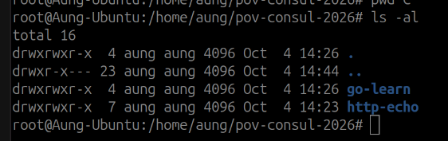
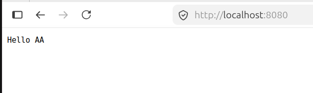
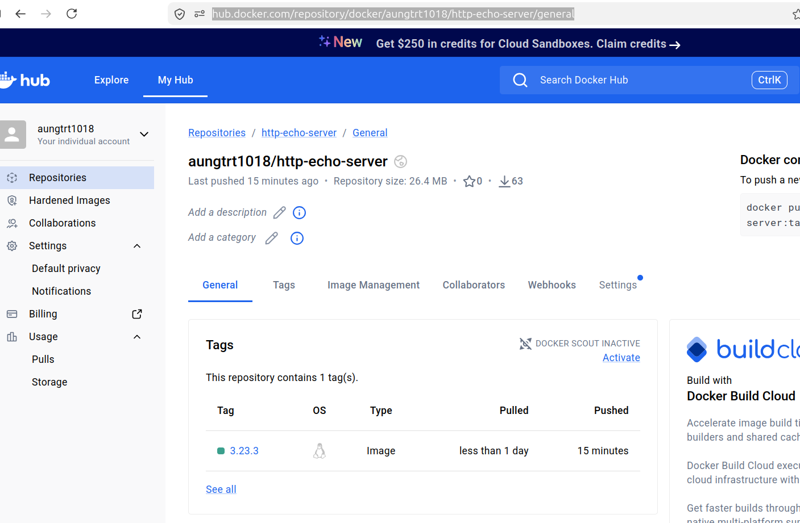

#### Install Go Lang To build binary
```
sudo apt install golang-go
mkdir - p /home/aung/pov-consul-2026
git clone https://gitlab.com/sailinnthu/go-learn
```

#### Build http-echo and output as /home/aung/pov-consul-2026/g0-learn/pkg/linux_amd64/http-echo

```
git clone https://github.com/hashicorp/http-echo.git
cd http-echo
CGO_ENABLED=0 GOOS=linux GOARCH=amd64 go build -o /home/aung/pov-consul-2026/go-learn/pkg/linux_amd64/http-echo .
chmod +x pkg/linux_amd64/http-echo
```

#### Docker Build image and push to docker hub

```
docker login
IMAGE_NAME=aungtrt1018/http-echo-server 
IMAGE_TAG=3.23.3 
docker build -t ${IMAGE_NAME}:${IMAGE_TAG} . docker tag ${IMAGE_NAME}:${IMAGE_TAG} ${IMAGE_NAME}:${IMAGE_TAG} docker push ${IMAGE_NAME}:${IMAGE_TAG}
```



#### Verification
```
docker run --rm -p 8080:5678 aungtrt1018/http-echo-server:3.23.3 -text="Hello AA" 
```




#### PUll image from docker hub and run as container
```
docker rmi aungtrt1018/http-echo-server:3.23.3
docker pull aungtrt1018/http-echo-server:3.23.3
docker run --rm -p 8080:5678 aungtrt1018/http-echo-server:3.23.3 -text="Hello BB"
```


